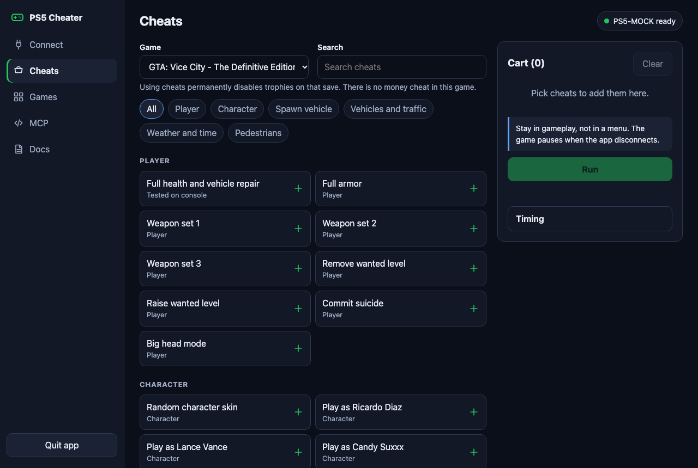

# PS5 Cheater (no jailbreak)

Pick cheats from a list like items in a cart, press **Run**, and your Mac types the button codes into the game for you. It works on a stock PS5 through Sony's own Remote Play, so nothing is installed or changed on the console.

It is not tied to one game. Cheats live in a local SQLite database, and you, or an AI agent connected over [MCP](docs/MCP.md), can add any game whose cheats are button sequences. GTA: Vice City - The Definitive Edition comes built in, with 52 cheats.

> Screenshots come from the built-in demo mode, which is why the console is called `PS5-MOCK`.

## What it does

- **One connection per run.** It connects once, types every cheat in order, waits 2 seconds and disconnects once.
- **Connection status.** See whether the console is found, paired and ready.
- **Network discovery.** Finds the PS5 on your network, including when a VPN owns the default route.
- **Open game check.** Grabs a real frame from the console, because the PS5 does not report which game is running.
- **Your own library.** Add games and cheats, and import or export JSON packs.
- **MCP server.** Lets an agent list, add and run cheats and look at the screen.
- **Built-in docs.** The same help is available inside the app.

## What it does not do

- It does not modify the game, the save format or the console.
- It only presses buttons a player could press. A game must have button cheats for this to help.
- It is meant for **single-player** games. Do not use it in online modes.

## Requirements

| Item | Needed |
| --- | --- |
| Console | PS5 with Remote Play turned on |
| Computer | Mac with Apple silicon for the ready-made app; any Mac with Python 3.10 to 3.12 from source |
| Network | Mac and PS5 on the same local network |
| Account | The PlayStation Network account used on the console |

Windows and Linux have no ready-made app. They are untested.

## Quick start

### 1. Download

Get `PS5-Cheater-<version>-macos-arm64.zip` from the [latest release](https://github.com/Lamentoss/ps5-cheater-wo-jb/releases/latest), unzip it and move **PS5 Cheater** to Applications.

### 2. Open it the first time

The app is not signed with an Apple Developer certificate, so macOS stops it.

1. Double-click the app and close the warning.
2. Open **System Settings > Privacy & Security**.
3. Scroll down and click **Open Anyway**.

The app has no window of its own. It opens a page in your browser at `http://127.0.0.1:8765`.

### 3. Allow local network access

Click **Allow** when macOS asks whether PS5 Cheater may find devices on your local network. Without this, the status badge shows **Network blocked**.

### 4. Connect

Follow the four steps on the **Connect** page: find the console, sign in, pair and check the screen. [docs/CONNECT.md](docs/CONNECT.md) explains each one.

### 5. Run cheats

1. In the game, be in normal gameplay, not in a menu.
2. On the **Cheats** page, add what you want to the cart.
3. Press **Run**.

The first run takes about 10 seconds to connect. Keep your hands off the controller until it finishes.

**The game pauses when the app disconnects.** This is how Remote Play behaves. Unpause the game yourself. The app does not try to do it, because which button is safe depends on the game.

## Good to know

- In the Vice City pack, using a cheat permanently disables trophies on that save. Some cheats cannot be undone, and the app warns you about those. Keep a separate save.
- Only **Full health and vehicle repair** and **Full armor** have been confirmed by watching their effect on a real console. The other cheats come from a public list, so they are not marked as tested.
- `Another Remote Play session` means the PS5 has not released the last one yet. The app retries for up to 40 seconds.

## Documentation

| Guide | Covers |
| --- | --- |
| [Connecting](docs/CONNECT.md) | First-time setup, step by step |
| [MCP](docs/MCP.md) | Connecting an agent and the available tools |
| [Adding games](docs/ADDING_GAMES.md) | Pack format, allowed buttons, timing |
| [Troubleshooting](docs/TROUBLESHOOTING.md) | Common problems and fixes |
| [Building](docs/BUILDING.md) | Running from source, tests, packaging |

## Privacy

Everything stays on your Mac. The servers listen on `127.0.0.1` only and refuse requests from other websites. Your PlayStation sign-in goes directly to Sony, and the pairing data is stored in `~/.pyremoteplay`. Never share that folder.

## License

GPL-3.0-or-later, because it builds on [pyremoteplay](https://github.com/ktnrg45/pyremoteplay). See [LICENSE](LICENSE).

This project is not affiliated with or endorsed by Sony Interactive Entertainment or Rockstar Games. PlayStation, PS5 and Remote Play belong to Sony. Game names belong to their owners.
