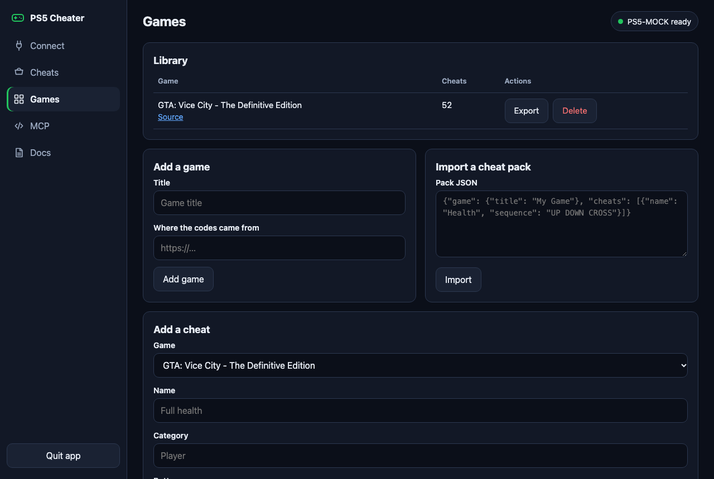

# Adding games and cheats

Any game that accepts cheats as button presses during play can be added. Cheats that need a typed word, a menu toggle or a trainer cannot.



## From the app

1. Open **Games** and add the game.
2. Add cheats one at a time, or import a JSON pack.

## Pack format

```json
{
  "game": {
    "id": "my-game",
    "title": "My Game",
    "platform": "PS5",
    "notes": "Shown above the cheat list.",
    "source": "https://example.com/where-the-codes-came-from"
  },
  "cheats": [
    {
      "name": "Full health",
      "category": "Player",
      "sequence": "R1 R2 L1 CIRCLE LEFT DOWN RIGHT UP",
      "warning": "Cannot be turned off.",
      "verified": false
    }
  ]
}
```

| Field | Required | Meaning |
| --- | --- | --- |
| `game.title` | Yes | Display name |
| `game.id` | No | Stable id. Made from the title when missing |
| `game.platform`, `notes`, `source` | No | Extra details |
| `cheats[].name` | Yes | Display name |
| `cheats[].sequence` | Yes | Buttons separated by spaces, or a JSON list |
| `cheats[].category` | No | Group name, `General` by default |
| `cheats[].slug` | No | Stable id. Made from the name when missing |
| `cheats[].warning` | No | Shown before running |
| `cheats[].verified` | No | Set to `true` only after seeing it work on a console |

Importing a pack again updates cheats with the same slug. A full example is in [`src/ps5cheater/seed/gta-vice-city-de.json`](../src/ps5cheater/seed/gta-vice-city-de.json).

## Allowed buttons

```text
UP DOWN LEFT RIGHT L1 R1 L2 R2 CROSS CIRCLE SQUARE TRIANGLE
```

Cheats that use other buttons cannot be added. `OPTIONS`, `SHARE`, `PS`, `L3`, `R3` and `TOUCHPAD` are not sent correctly by the Remote Play library in use, so the app refuses them. This also means a game that needs the Options menu to enter a code will not work.

## Timing

Open **Timing** in the cart. The defaults worked on a real console in Vice City.

| Setting | Default | Meaning |
| --- | --- | --- |
| Hold | 0.08 s | How long each button stays down |
| Gap | 0.08 s | Pause between buttons |
| Between | 0.3 s | Pause between cheats |
| Tail | 2.0 s | Wait after the last cheat before disconnecting |

If a game misses presses, raise Hold and Gap a little.
