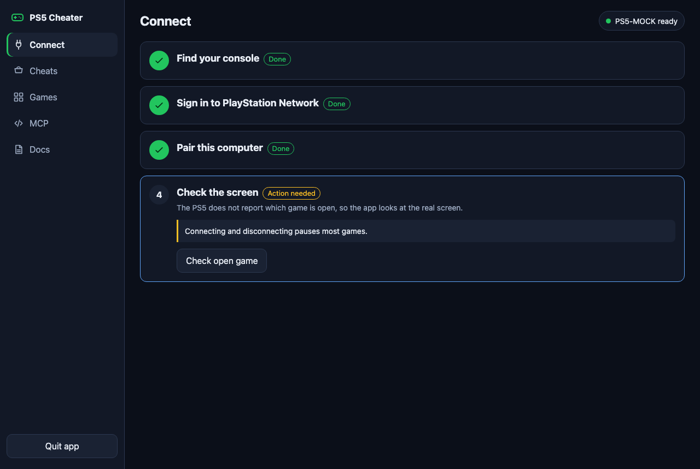

# Connecting your PS5

You only do this once. The app remembers the console afterwards.

## Before you start

1. On the PS5, open **Settings > System > Remote Play** and turn on **Enable Remote Play**.
2. Connect the Mac and the PS5 to the same network.
3. Turn the PS5 on. A console in rest mode may need waking first.

## Step 1: Find your console

Press **Search network**. If one console answers, the app selects it. If several answer, pick yours.

If nothing is found, open **Enter the address by hand** and type the console's IP address. You can see it on the PS5 under **Settings > Network > View Connection Status**.

If the badge says **Network blocked**, allow local network access first. See [Troubleshooting](TROUBLESHOOTING.md#network-blocked).

## Step 2: Sign in to PlayStation Network

Remote Play needs to know which account is yours.

1. Press the sign-in link. Sony's page opens in your browser.
2. Sign in with the account used on the console. You type your password on Sony's page, never in this app.
3. You end up on a blank or error page. That is expected.
4. Copy the full address from the browser's address bar.
5. Paste it into the app and confirm.

## Step 3: Pair this computer

1. On the PS5, open **Settings > System > Remote Play > Link Device**.
2. An 8-digit code appears. It only lasts a few minutes.
3. Type the code into the app and press **Pair console**.

## Step 4: Check the screen

Press **Check open game**. The app connects, grabs one frame and disconnects. No buttons are pressed.

This is the only way to see what is running, because the PS5 does not report the open game over the network. Connecting and disconnecting pauses most games, so this check is best done before you start playing.

## You are ready

Go to **Cheats**, fill the cart and press **Run**.

To pair a different console or account, repeat steps 1 to 3.
