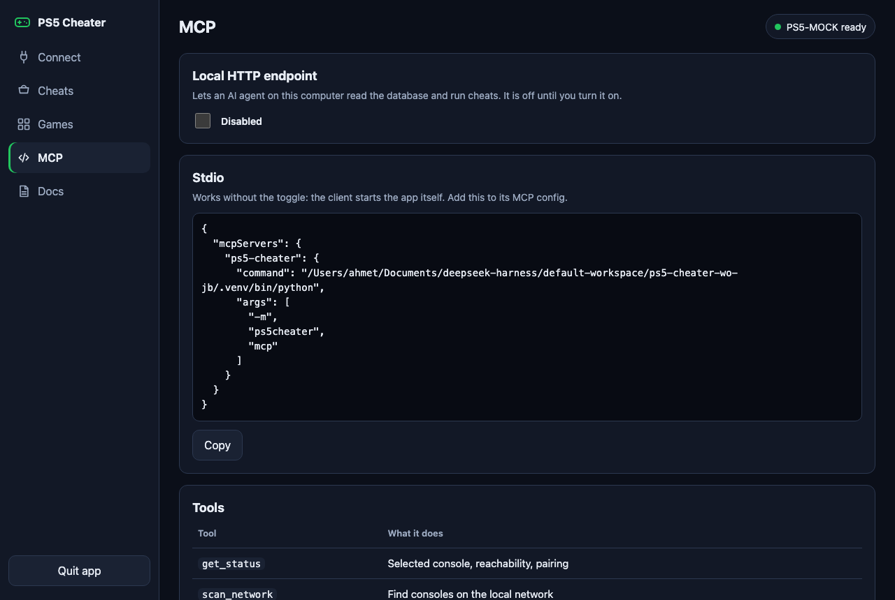

# Connecting an agent over MCP

With [MCP](https://modelcontextprotocol.io) an AI agent can read your cheat library, add new games and run cheats on your console. It works with Claude Code and any other MCP client.



There are two ways to connect. Both use the same database as the app.

## Option 1: HTTP

Use this when the app is open.

1. Open the app and go to the **MCP** page.
2. Turn on the MCP server. It listens on `http://127.0.0.1:8766/mcp`.
3. Add it to your client. For Claude Code:

   ```bash
   claude mcp add --transport http ps5-cheater http://127.0.0.1:8766/mcp
   ```

## Option 2: stdio

Use this to let the client start the server itself. The app does not need to be open.

```json
{
  "mcpServers": {
    "ps5-cheater": {
      "command": "/Applications/PS5 Cheater.app/Contents/MacOS/ps5-cheater",
      "args": ["mcp"]
    }
  }
}
```

The **MCP** page shows this block with the right path for your install. From source, use the `ps5-cheater` script in your virtual environment with the same `mcp` argument.

## Tools

| Tool | What it does | Touches the console |
| --- | --- | --- |
| `get_status` | Console, pairing and network state | Status query only |
| `scan_network` | Finds consoles on the local network | Status query only |
| `list_games` | Lists games | No |
| `list_cheats` | Lists a game's cheats, with an optional search | No |
| `add_game` | Adds a game | No |
| `add_cheat` | Adds a cheat to a game | No |
| `delete_cheat` | Deletes a cheat | No |
| `import_pack` | Imports a whole [cheat pack](ADDING_GAMES.md) | No |
| `capture_screen` | Connects, returns a frame, disconnects | **Yes, pauses most games** |
| `run_cheats` | Runs cheats, returns the result and a frame | **Yes, presses buttons** |

## Example prompts

- "What game is open on my PS5?"
- "Find the button cheats for this game and add them as a pack, with the source."
- "Give me full armor and a weapon set."

## Before you let an agent run cheats

- `run_cheats` presses real buttons on your console. If the game is paused or in a menu, those presses land there instead.
- An agent can add a wrong code. Cheats it adds are not marked as tested until they are.
- Only one run can happen at a time. A second one fails with `Another run is in progress.`

## Security

The HTTP server accepts only `127.0.0.1` and `localhost`. A wrong `Host` header gets 421 and a request from another website's origin gets 403. It has no password, so any program on your Mac can reach it while it is on. Turn it off when you are not using it.
